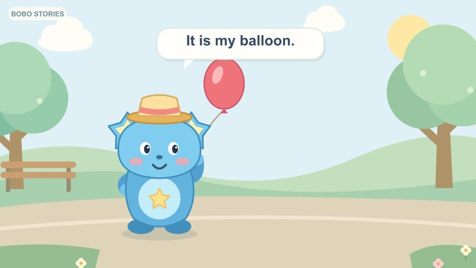
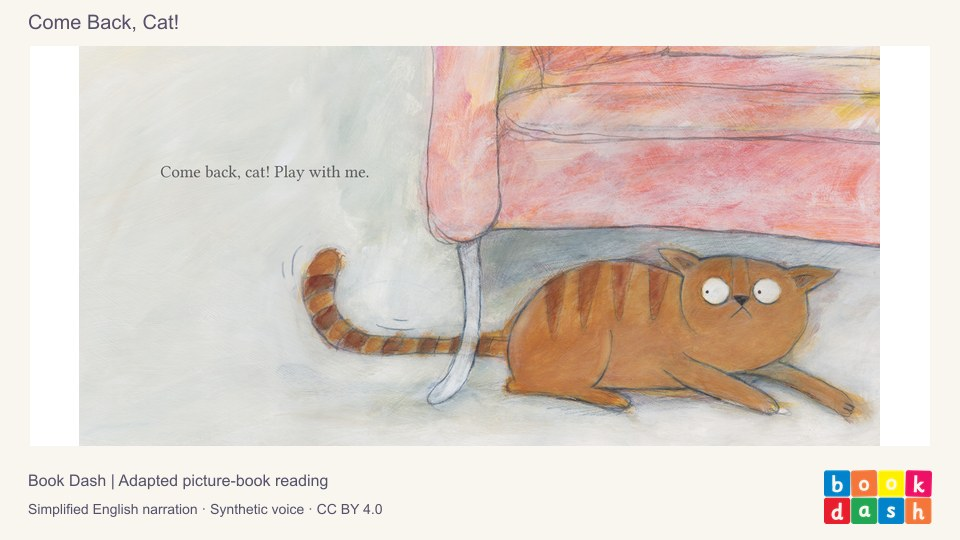
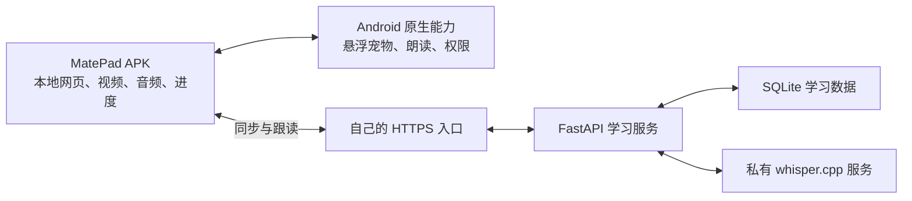

<p align="center">
  
</p>

# 星伴英语 · StarPet English

**让中文母语的小学生，跟着桌面宠物波波听懂英语、愿意开口。**

[](LICENSE)
[](https://github.com/lianzhang132/starpet-english/releases)
[](https://github.com/lianzhang132/starpet-english/actions/workflows/checks.yml)

这是一个可自行部署的英语学习应用：有宠物陪伴、字母与拼读、情景口语、间隔复习，以及带中文支撑和理解题的趣味故事。

**当前交付路线是 HarmonyOS 4.2 兼容 Android APK**，已在 HUAWEI MatePad 11.5 上进行开发验证。学习界面使用 APK 内置的 HTML / CSS / JavaScript；动态桌面宠物、语音播放与系统权限使用 Android 原生 Java。仓库也保留了面向 HarmonyOS 5.0 / API 12 的 ArkTS 工程，**该工程尚未完成编译、签名和真机验收**。

项目仍在完善，欢迎用于学习、试用和贡献。它尚未覆盖完整小学 1–6 年级课程，也不承诺自动发音反馈可以替代教师评价。

## 可以做什么

| 功能 | 当前内容 |
| --- | --- |
| 宠物伙伴 | 波波家园、喂养和互动、成长奖励；可拖动的动态悬浮宠物，限频发出英语邀请 |
| 基础课程 | 6 个主题世界、24 节课程、96 道题，支持词卡、听音辨词和选项发音 |
| 字母与拼读 | 26 个字母、10 组常见组合音、12 个三音拼读词及听音练习 |
| 情景口语 | 6 个生活场景、18 句跟读，以及 5 个受控的两轮问答话题 |
| 主动复习 | 到期内容优先，避免同日反复推送；按掌握情况安排 1 / 3 / 7 / 14 / 30 天复习 |
| 故事视频 | **14 个视频**：1 集 3D 动画导读、6 集有声绘本、3 集波波故事、4 集基础短片 |
| 学习互动 | 视频中文提示、逐句重听、理解题、自愿开口邀请；已观看内容可直接进入待完成理解题 |
| 英语示范音 | **433 条内置合成英语音频**，未覆盖文字由系统语音补充 |
| 进度保存 | 本地保存、断网待同步队列、请求去重与版本冲突保护 |

视频和示范音频随 APK 安装，离线观看无需请求第三方视频平台。**在线跟读识别和进度同步需要连接你自己部署的服务**。已有本地内容可以离线学习，但断网时不提供服务器识别结果。

## 故事内容

<p>
  
  
  
</p>

- 波波故事和基础短片：项目原创教学内容与动画。
- 6 集绘本：基于 **Book Dash / CC BY 4.0** 原作制作的有声绘本，保留作者、插画师等署名与改编说明。
- 3D 动画：基于 **Blender Studio《Caminandes: Llamigos》/ CC BY 4.0** 制作英语导读版，保留完整原片、配乐及制作名单。原片没有英语对白，英语学习讲述为本项目后配。

这里的有声绘本不等同于完整角色动画；示范声音为合成音，非真人录制。第三方作品没有为本应用背书。完整来源及许可见 [第三方说明](THIRD_PARTY_NOTICES.md)。

## 架构



- **界面**：原生 JavaScript 模块，无需前端打包工具；Android 使用 WebViewAssetLoader 读取本地资源。
- **服务**：Python 3.12、FastAPI、SQLite；Docker Compose 可同时运行学习服务和识别服务。
- **识别**：生产配置使用私有 `whisper.cpp` 与 `small.en-q5_1` 模型；保留 Vosk 兼容实现。默认不连接商业 AI API。
- **数据**：随机设备标识关联进度；没有用户账号找回或多设备自动合并功能。
- **媒体**：`server/app/static/videos/` 存放 MP4、封面、VTT 字幕及来源清单；构建 APK 时复制进 `assets/static/videos/`。

公开版本不含私人部署域名、学习数据库、设备录音、签名私钥或模型权重。默认服务器地址是占位地址，供部署者替换。

## 快速开始：在电脑上运行

需要 Python 3.12；Node.js 22 用于自动检查，JDK 17 / Android SDK 用于 APK 构建。

```bash
git clone https://github.com/lianzhang132/starpet-english.git
cd starpet-english
python -m venv .venv
```

启用环境：

```powershell
# Windows PowerShell
.\.venv\Scripts\Activate.ps1
```

```bash
# macOS / Linux
source .venv/bin/activate
```

安装并启动：

```bash
python -m pip install -r server/requirements-dev.txt
python -m uvicorn app.main:app --app-dir server --host 127.0.0.1 --port 8000
```

打开 **http://127.0.0.1:8000**。此时可以浏览课程、播放视频和体验宠物；未安装识别模型时，跟读服务会显示不可用，不会伪造评测结果。学习数据库在首次运行时自动生成，不需要复制任何已有数据。

接口状态：`/api/health`；识别状态：`/api/v1/speech/status`；接口文档：`/docs`。

## 构建 Android / HarmonyOS 4.2 兼容 APK

1. 安装 **JDK 17、Android SDK Platform 35、Build Tools 35.0.0**，配置 `JAVA_HOME` 和 `ANDROID_HOME`。
2. 修改 `config/deployment.json` 中的 `apiOrigin` 为你部署的 **HTTPS 服务根地址**；不需要备用入口时保留空字符串。
3. 导出课程和客户端连接配置，再构建：

```bash
python tools/export-curriculum.py
cd android
./gradlew assemblePreview testPreviewUnitTest lintPreview
```

Windows 使用 `gradlew.bat`。输出文件：`android/app/build/outputs/apk/preview/app-preview.apk`。

`preview` 是用于内部试用的非调试构建，使用构建机的 Android 调试签名；正式商店发布前应自行配置发布签名。请妥善保存自己的密钥，勿提交到仓库。

Windows 路径包含中文且构建工具出现编码问题时，可将仓库放到纯英文路径，或使用 [构建辅助脚本](tools/build-android.ps1) 创建受检查的本地目录联接。

发布页的 **offline-demo APK** 使用占位服务器地址，只提供内置内容和本地体验。启用同步、跟读需要修改配置并自行构建；它不会连接原作者的私人服务。

### 鸿蒙原生工程

`AppScope/`、`entry/`、`hvigor/` 为保留的 ArkTS 路线，使用 Stage 模型、HarmonyOS 5.0 / API 12 配置。可在对应版本的 DevEco Studio 中打开研究；尚不能将其视为已验证的原生 HAP 发行版。HarmonyOS 4.2 平板请使用前述兼容 APK。

## 自行部署语音服务

在安装 Docker Compose 的 Linux 主机上，进入仓库，先下载固定版本的 Whisper 模型。下载脚本检查大小和 SHA-256，不覆盖不匹配的已有文件。

```bash
bash tools/install-whisper-model.sh
cd server
docker compose up -d --build
curl http://127.0.0.1:3210/api/health
curl http://127.0.0.1:3210/api/v1/speech/status
```

首次构建需要访问上游源码与模型站点。Compose 为 API 与 ASR 分别设置了资源限制；识别延迟取决于主机性能。ASR 不映射公网端口，由 API 通过容器内部网络访问。

使用自己的反向代理或隧道提供 HTTPS。**公开源码不等于已完成面向公众运营的部署**：当前随机设备标识不是完整身份认证，正式对外服务前需要落实访问控制、流量限制、备份、隐私与应用上架要求。详见 [安全说明](SECURITY.md)。

持久化目录在 `server/` 下：

| 目录 | 用途 |
| --- | --- |
| `data/` | SQLite 数据库与本机备份，已排除版本管理 |
| `models/` | 私有识别模型，已排除版本管理 |
| `downloads/` | 可选的安装包下载目录，已排除版本管理 |

运行备份：`docker compose exec starpet-api python -m app.backup`。本机备份仍需自行安排异地副本与恢复演练。

## 开发与验证

```bash
# JavaScript：学习计划、视频、录音状态、播放控制等
npm test

# Python：课程、进度同步、跟读服务、备份等
python -m pytest -q

# Android：桥接策略、媒体读取、宠物策略等
cd android
./gradlew testPreviewUnitTest lintPreview
```

自动检查无需连接平板或真实麦克风。它们不能证明真实儿童的识别准确率、声音自然度或学习效果；这些需要单独开展真人与真机验证。

课程源数据在 `server/app/`。修改后运行 `python tools/export-curriculum.py` 更新网页、APK 和 ArkTS 共用的导出数据。离线音频、视频重建流程见 [媒体制作说明](docs/MEDIA.md)，日常运行无需重新生成。

## 目录

```text
android/                 当前兼容 APK：原生壳、宠物、语音与权限
server/app/              FastAPI、课程数据、学习与识别逻辑
server/app/static/       本地学习界面、433 条音频和 14 个视频
server/asr/              私有 whisper.cpp 识别容器
server/tests/            Python 与 JavaScript 自动检查
entry/                   尚待验收的 ArkTS 原生客户端
AppScope/                鸿蒙应用配置与图标
config/deployment.json   自行部署的服务地址
tools/                   课程导出、模型安装、媒体生成与检查
docs/                    媒体制作及公开发行说明
```

## 儿童使用与当前边界

- 点击录音且获得家长同意、系统授权后才采集声音；宠物主动邀请不会自动启动麦克风。
- 跟读声音上传到你部署的服务处理。当前识别路径不把原始声音或识别文本写入学习数据库。
- 跟读反馈是**识别后与目标句的句子匹配**，不是专业音素级发音评分；噪声、年龄和口音都可能影响结果。
- 互动对话限定在教学话题和安全的固定回应范围内，未接入开放式聊天。
- 应用不采集真实姓名、手机号或精确位置，但设备标识、学习记录及服务访问日志仍应按实际部署情况做好保护。
- 清除应用数据后不能保证找回原进度；当前没有完整的账号恢复与多儿童档案系统。

## 接下来完善

完整的优先级、依赖和验收标准见 [完善路线图](docs/ROADMAP.md)。

- [ ] 真实儿童跟读复测、降低误识别造成的挫败感
- [ ] 更自然的示范音与更系统的字母音教学
- [ ] 完整的分级课程、更多有明确授权的故事
- [ ] 家长时长管理、多儿童档案与账号恢复
- [ ] 桌面宠物后台稳定性、长期耗电与系统兼容验证
- [ ] 内容按需下载、离线缓存与独立内容更新
- [ ] 完成 HarmonyOS 原生工程的构建与验收

## 开源与贡献

项目自有代码及原创课程文本按 **[MIT](LICENSE)** 开源。**第三方绘本、动画、商标及相关素材不因本仓库使用 MIT 而改变许可证**；请阅读 [THIRD_PARTY_NOTICES.md](THIRD_PARTY_NOTICES.md) 和随素材保留的署名文件。

欢迎通过 [Issues](https://github.com/lianzhang132/starpet-english/issues) 反馈或提交 PR，见 [贡献指南](CONTRIBUTING.md)。反馈中请勿附上儿童录音、私人账号、设备标识或家庭信息。
